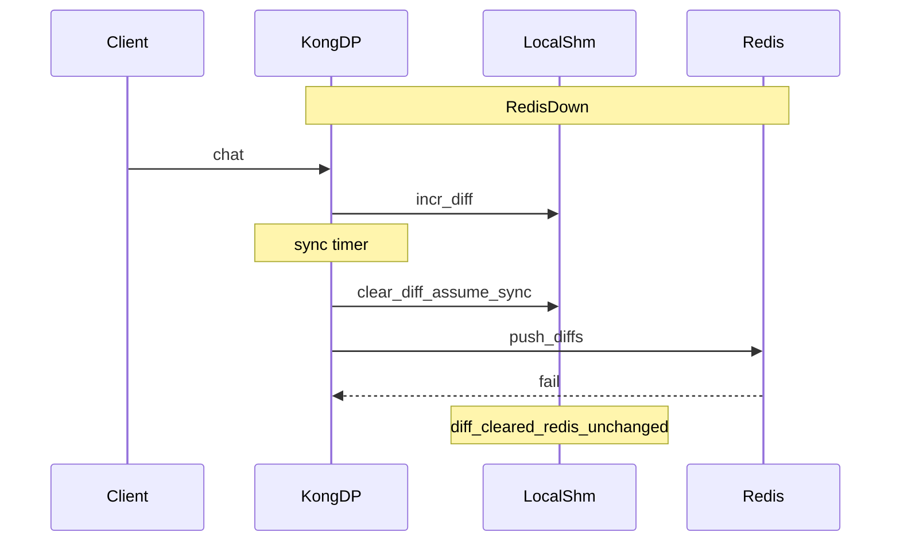
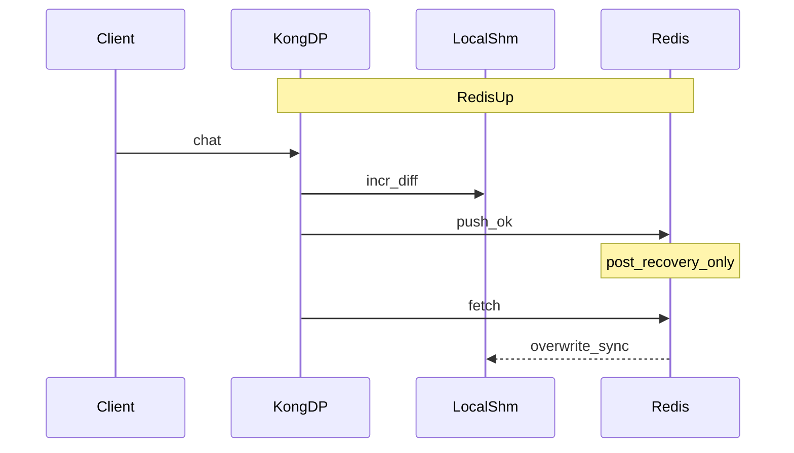

# Redis 장애·복구 시 AI Rate Limit 동작

`ai-rate-limiting-advanced`를 `strategy: redis`로 쓰면 토큰 사용량은 Data Plane 로컬 버퍼와 Redis에 함께 쌓입니다. Redis가 잠깐 죽거나 연결이 끊겨도 요청은 로컬 한도로 계속 통과합니다. 문제는 복구 시점입니다. 장애 구간에 로컬에만 쌓인 양이 Redis로 소급 반영되지 않습니다.

이 글은 그 관측 결과와 이유를 정리합니다.

## 목적

- Redis strategy AI Rate Limit에서 **장애 중 / 복구 후** 카운터가 어디에 남는지 확인합니다.
- 로컬에 누적된 diff가 복구 후 Redis로 **catch-up되지 않는** 이유를 코드 경로와 실측으로 맞춥니다.
- 운영 시 Redis HA·`sync_rate`·다중 DP가 전역 한도에 주는 영향을 짧게 정리합니다.

## 적용 방식

AI Rate Limiting Advanced에서 Redis를 쓰려면 대략 다음이 필요합니다.

| 항목 | 역할 |
|------|------|
| `strategy: redis` | 중앙 저장소를 Redis로 둡니다. |
| `sync_rate` | `> 0`이면 주기적 비동기 sync, `0`이면 요청 경로에서 동기 push. |
| `redis` / redis-ee partial | host·port·password 등 연결 정보. |
| `namespace` | 카운터·sync 설정을 격리하는 키 공간. |
| `policies` (또는 deprecated `llm_providers`) | `total_tokens` 등 토큰 한도와 window. |

동기화 라이브러리는 Rate Limiting Advanced와 동일한 `kong.tools.public.rate-limiting`입니다. 요청마다 로컬 shm에 `|diff`를 올리고, sync 주기(또는 `sync_rate: 0`)에 Redis로 push한 뒤 Redis 값을 fetch해 `|sync`를 맞춥니다.

공식 문서의 [Fallback from Redis](https://developer.konghq.com/gateway/rate-limiting/strategies/)는 연결이 끊기면 local로 폴백하고, 복구 후 다시 sync한다고 설명합니다. 아래 실측은 **복구 후 sync는 재개되지만, 장애 중 로컬 누적분이 Redis에 합쳐지지는 않는다**는 점을 구체화합니다.

## 정상 키 구조

Redis 키는 window 단위 HASH입니다.

```text
{window_start}:{window_size}:{namespace}
```

예: `1710000000:300:ai-rla-ns`

- field: identifier (정책 매칭 결과에 따라 `policy:1:provider:openai` 등)
- 연산: `HINCRBY` (또는 fractions 설정 시 `HINCRBYFLOAT`)
- TTL: `EXPIRE = 2 * window_size`

같은 window 안에서는 **새 KEY가 생기지 않고** 같은 HASH의 field 값만 증가합니다. window가 바뀌면 `{새 window_start}:{size}:{namespace}` KEY가 생깁니다.

## 장애 중 시퀀스

Redis에 push하지 못하는 동안에도 요청 처리는 로컬 카운터로 이어집니다. sync 타이머는 실패해도 로컬 `|diff`를 이미 비우고 `|sync`를 올려 둔 뒤, push 실패만 로그로 남깁니다. 롤백이 없습니다.



주요 내용은 다음과 같습니다.

1. 요청 → 로컬 `|diff` 증가 (토큰 차감·Remaining 헤더 반영).
2. sync → `|diff`를 0으로 만들고 `|sync`에 같은 양을 더함 (성공을 가정).
3. `push_diffs` 실패 → Redis HASH는 그대로.
4. 다음 요청도 로컬 기준으로 계속 카운트.

## 로그 예시

장애 구간 Data Plane 로그에는 아래 패턴이 반복됩니다.

```text
[error] [ai-rate-limiting-advanced] error in pushing diffs for namespace <ns>: failed to connect to redis: <reason>
[error] [ai-rate-limiting-advanced] error in fetching counters for namespace <ns>: failed to connect to redis: <reason>
```

`<reason>`은 환경에 따라 `Connection refused`, timeout, 인증 실패 메시지 등으로 달라집니다. Redis 프로세스가 내려간 경우뿐 아니라 인증·네트워크 단절도 같은 push/fetch 실패 경로입니다.

strategy 구현(`redis_v2`) 쪽 메시지는 대략 다음입니다.

- `failed to connect to redis: ...`
- `failed to push diff pipeline: ...`

플러그인 래퍼는 이를 `error in pushing diffs for namespace ...` / `error in fetching counters for namespace ...`로 남깁니다.

## 복구 후 시퀀스

연결이 돌아오면 push·fetch가 다시 성공합니다. 다만 **복구 이후에 새로 생긴 `|diff`만** Redis에 반영됩니다. 장애 중 가정만 하고 push에 실패한 양은 Redis에 없습니다. fetch는 Redis 값으로 로컬 `|sync`를 덮어쓰므로, 노드 관점의 Remaining도 Redis 기준으로 되돌아갑니다.



실측 요약 (window 300초, limit 5000 `total_tokens`, `sync_rate: 1`):

| 시점 | 로컬 Remaining (응답 헤더) | Redis HASH field |
|------|---------------------------|------------------|
| 장애 직전 | 4747 | 266 |
| 장애 중 5회 chat | 4728 → 4652 (로컬만 감소) | **266 유지** |
| 복구 직후 (추가 요청 전) | — | **266 유지** |
| 복구 후 3회 chat | 4728 → 4690 (fetch 후 Redis 기준으로 재정렬) | 266 → **323** (+57) |

장애 중 로컬에서 줄어든 양(~95)은 Redis에 더해지지 않았습니다. 복구 후 증가분(+57)은 복구 이후 요청분만 반영된 결과입니다. 같은 window라면 새 KEY가 아니라 **기존 HASH field만** 증가합니다.

## AI Token Rate Limit

`tokens_count_strategy: total_tokens`(및 prompt/completion/cost)도 같은 rate-limiting 라이브러리를 씁니다. 따라서 장애·복구 동작은 요청 수 기반 RLA와 동일합니다.

- 장애 중 `X-AI-RateLimit-*` / 노드 로컬 관측값은 **그 DP의 로컬 카운터** 기준입니다.
- 복구 후 전역(Redis) 한도는 **장애 직전 Redis 값 + 복구 이후 push분**입니다.
- Data Plane이 여러 대면 장애 구간마다 노드 로컬 한도로 더 통과할 수 있어, 전역 한도가 의도보다 완화될 수 있습니다.

## 재현 절차 / 출력 예시

범용 절차는 다음과 같습니다. (로컬 Compose라면 Redis 컨테이너 stop/start로 동일하게 재현할 수 있습니다.)

1. `ai-rate-limiting-advanced`를 `strategy: redis`, 짧은 `sync_rate`, 관측 쉬운 window/limit으로 붙입니다.
2. 정상 요청 몇 회 후 Redis HASH를 확인합니다.
3. Redis를 중지하거나 연결을 끊습니다.
4. chat을 여러 번 호출하고 `X-AI-RateLimit-Remaining-*`와 DP 에러 로그를 확인합니다.
5. Redis HASH가 변하지 않는지 확인합니다.
6. Redis를 복구한 뒤 다시 chat하고, HASH 증가분이 **복구 이후 요청분**인지 비교합니다.

Redis 조회 예:

```bash
redis-cli -a "$REDIS_PASSWORD" KEYS '*:<window_size>:<namespace>'
redis-cli -a "$REDIS_PASSWORD" HGETALL '<window_start>:<window_size>:<namespace>'
```

응답 헤더 예 (정상):

```http
HTTP/1.1 200 OK
X-AI-RateLimit-Limit-300-policy-1: 5000
X-AI-RateLimit-Remaining-300-policy-1: 4747
```

장애 중 Remaining은 계속 줄고, Redis field는 그대로입니다. 복구 후 첫 성공 sync·fetch가 지나면 Remaining이 Redis 쪽으로 맞춰지고, HASH는 이후 요청분만 증가합니다.

## 운영 주의사항

- Redis를 단일 장애점으로 두지 않습니다. Sentinel/Cluster 등 HA를 전제로 둡니다.
- 공식 Fallback 문구의 “복구 후 sync”는 **이후 diff 재개**이지, 장애 중 로컬 누적의 **자동 catch-up이 아닙니다**. 예산·토큰 한도를 엄격히 지켜야 하면 장애 시간을 짧게 가져가거나, 장애 구간 트래픽을 줄이는 쪽이 맞습니다.
- `sync_rate`가 클수록 Redis 반영 지연이 커지고, `0`이면 요청 경로 동기화 비용이 증가합니다. 정확도와 성능 사이에서 선택이 필요합니다.
- 다중 DP에서는 장애 중 노드별 local 폴백이 겹치면 전역 한도보다 많은 토큰이 나갈 수 있습니다.

## 기대 vs 실제

| 구분 | 예상 동작 | 실제 동작 |
| --- | --- | --- |
| Redis 다운 중 | 로컬 카운터·`/metrics`·헤더는 계속 증가 | 그렇게 동작함 (노드 로컬 shm) |
| Redis 복구 후 | 로컬에 쌓인 분까지 Redis에 반영 | **반영 안 됨** — Redis는 장애 직전 값에서 **복구 이후 push된 diff만** 증가 |
| Remaining / metrics | 로컬과 Redis가 합쳐질 것 | fetch 후 **Redis 기준으로 로컬 ` |

::: info Info
“복구 = 백로그 flush”가 아니라 **“복구 = sync 타이머가 다시 push/fetch”** 로 동작합니다.
:::

예를 들어, “다운 중에 로컬에서만 +100 쌓였는데, Redis는 +0” → “복구 후 새 요청 +20만 Redis에 +20” 같은 패턴이 발견 될 수 있습니다.

공식 문서 [Fallback from Redis](https://developer.konghq.com/gateway/rate-limiting/strategies/) 에서는 “끊기면 local로, 연결되면 다시 sync”라고 표현 합니다. 여기서 sync는 이후에 새로 생기는 diff를 다시 push/fetch한다는 뜻을 의미하며, 다운 타임 동안 이미 버려진 diff를 소급 반영한다는 뜻은 아닙니다.

## 참고

- [Rate limiting strategies / Fallback from Redis](https://developer.konghq.com/gateway/rate-limiting/strategies/)
